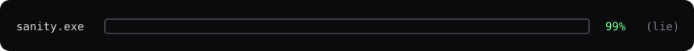

<p align="center">
  
</p>

<p align="center">
  
</p>

<h3 align="center">hello. the terminal is typing. i am not.</h3>

<p align="center"><sub>please keep your hands inside the repository at all times.</sub></p>

---

### currently haunting

<a href="https://qusaialjbali.github.io/commons-ui/">
  
</a>

**[Commons UI](https://github.com/qusaialjbali/commons-ui)** is a free zine of interface parts in HTML, React, Vue and Svelte. Copy anything, credit nobody, ship it tonight. It also talks to your AI agent, which is the least haunted thing about it.

```sh
npx commons-ui-zine add password-creature   # it covers its eyes while you type. polite.
npx commons-ui-zine add hold-to-confirm     # for when "are you sure?" is not enough.
```

### known side effects

| symptom | likelihood | cure |
| --- | --- | --- |
| centering a div on the first try | rare | none. enjoy it. |
| the urge to add one more animation | constant | `prefers-reduced-motion: reduce` |
| reading the whole readme | you are here | scroll back up, the terminal missed you |
| hearing a cursor blink | after midnight | close the tab. it will still be blinking. |

### daily system log

<!-- HAUNT:START -->
```
[system log · night 1 since it woke up]
> a div was centered on the first try. the building was evacuated as a precaution.
```
<!-- HAUNT:END -->

<details>
<summary><b>do not open</b></summary>

<br>

you opened it.

it now knows your name. (it doesn't. nothing here collects anything. but it *feels* like it does, doesn't it.)

as a reward, here is the one rule that never changes: **make the button look like a button.**

</details>

<p align="center"><sub>this readme is rewritten every night by a cron job that has never once been asked how it's doing.</sub></p>
